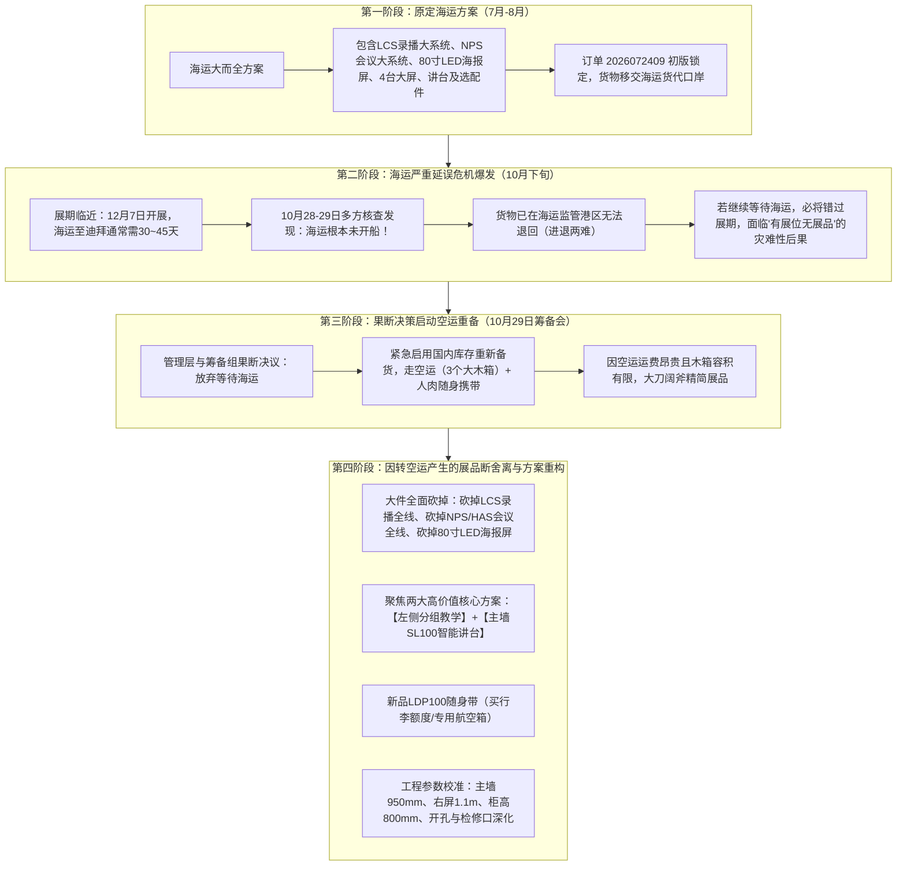

# GITEX GLOBAL Dubai 2026｜项目主档

[toc]

> 这是当前状态入口。详细事件、替代决策、产品变更和全部行动项见 [项目历史台账](./过程文件/项目历史台账.md)；施工图 17 项需求基准见 [施工图深化核对清单-15项逐一验收表.md](./施工图深化核对清单-15项逐一验收表.md)；**1030 新版施工图（全 12 页）逐项审查与跟进状态见 [1030施工图审查问题与二次确认清单.md](./1030施工图审查问题与二次确认清单.md)**。原始会议纪要和群聊证据不得覆盖。

## 1. 当前基线

| 项目 | 当前有效结论 |
| --- | --- |
| 展会身份 | **GITEX GLOBAL Dubai 2026**；以群名为准，不按遗留目录名 `迪拜GESS` 判断展会身份。 |
| 时间与地点 | 2026-12-07 至 12-11；12 月 7 日 Scale Summit 在 DWTC，Expo 为 12 月 8–11 日、Expo City Dubai。 |
| 展位 | `H3-A52`；**5.0 m × 5.0 m = 25㎡**。正方形展台，斜切门头配 LED 发光标识。 |
| 核心组织角色 | **销售团队领导**：Jason；**技术团队/现场执行主力**：王力（Lee）；**商务/订单协调**：张婷；**特装搭建商**：杭州励创（对接人：CC；微信对接群：《锐达互动&杭州励创 -2026迪拜gitex搭建》）；**展台与美工总协调**：陈冰雯；**物料与支架支持**：章明。 |
| 柜体与高度尺寸 | **柜高降至 800mm，三面墙液晶离地统一为 1000mm**：左右两侧柜体高度由 850mm 下调至 **800mm**（单块宽 2m、单格 60cm），为台面预留 200mm 操作净空；**左墙、主墙、右墙所有 65 寸液晶离地高度最终统一改为 1000mm**（原 1300mm 过高废弃，会后张婷群发 15 条指令锁定为 1000mm）。左侧柜体内移，集中收纳备用路由器（3张流量卡）、耀强本地离线 OPS 及排插。 |
| 穿线与开孔规范 | **墙体暗埋垂直垂落、主墙绝对防阻与多检修口（对应群发 15 条指令）**： 1. 主墙左屏左下角背后开孔：**离地 1100mm、离左边 900mm**；右屏左下角背后开孔：**离地 1100mm、离左边 2400mm**； 2. **主墙背后 20cm 夹层内严禁有横向承重木板阻挡**，确保双屏背后开孔线缆顺畅穿至底部检修口； 3. **主墙检修口**：**离地 150mm、长 500mm、宽(高) 250mm**，位于主墙正下方对应 SL100，面板可开启； 4. **左墙齐平插座**：左墙至少预留 **2 个两孔及以上墙面插座**，**必须与墙面齐平、不可凸出**； 5. **SL100 独立取电与排插**：**SL100 旁多加 1 个独立取电口**（因电源线短）；全展位至少准备 **4 个（建议 5~6 个）5孔英规插排**。 |
| 右侧生态与 CPL50 | 右侧 HY300 下方加一块承板（优先做成 **“Z”字形**，若不行则下方承板加长做 **1000mm**）；**门头右外框挂载 CPL50（离地高度 1400mm，墙体穿透开孔走 1 根网线）**；主墙两块液晶正下方居中加装 **1 台 SA200 全向麦**。 |
| 电源线方案 | **订单 2026072409**：4 套液晶屏（QA1400 Pro×2、TB1400D Pro×1、HN1000 Pro×1）换英规线，由金水备线、参展人员人肉带出；设备原包装内的原装国标电源线撤展时必须人肉带回国内（海报屏取消，海报屏线不需）。 |

---

## 2. 项目重大变更全过程：为什么转空运？（Why Air Freight）

根据 2026-10-29 会议录音及相关台账记录，项目物流保障体系由海运转为空运的完整演变过程如下：

### 2.1 变更根因：海运滞留未开船，面临撤展/开天窗绝境
1. **时间不可逆**：GITEX GLOBAL Dubai 2026 于 2026 年 12 月 7~11 日举行。常规海运自国内至迪拜港需 30~45 天，若 10 月底仍未离港，展前绝对无法完成清关提货。
2. **海运彻底停滞**：截至 2026 年 10 月 28~29 日复核，原定海运船期根本未开船（会议原文记录：“昨天说的应该是没开成，28号确认，29号了应该就没开成”）。
3. **陷入进退两难**：已发出的海运货物已进入监管港区，“也拿不回来”（会议原文：“进退两难。没得事，到时候你是主力哦，王力！”）。如果干等，现场展位将彻底开天窗；只有国内重新调拨库存空运抢运才能救场。

### 2.2 应对决策：启用空运重备（3 个木箱）与随身携带双轨制
* 2026-10-29 筹备组会同销售团队领导 Jason 与技术团队骨干王力（Lee）达成一致：**紧急启动备用库存，生成新版订单 `2026072409`，打包为 3 个大木箱空运发往迪拜**；
* 新品 `LDP100`（内置 OPS 与扬声器）直接由参展人员办理超规行李托运、装航空箱人肉带出。

### 2.3 因空运引发的方案深度重构（断舍离）
受限于空运的高昂运费与木箱限额，原有大系统无法全量复刻，必须实施极简高价值重构：
1. **砍掉 LCS 录播大系统**：LCS810 主机、CV210S 云镜、CV870PRO-T 跟踪摄像机、S210 麦克风、吊架、样机 C2500S 全部移除。
2. **砍掉 NPS 会议及升降桌大系统**：NPS150 终端、HAS10 电动升降桌、PS610 庞大音箱、NDP600 桌面讲台全部移除。
3. **砍掉 80 寸超大 LED 海报屏（LE18F80）**：免除超大件木箱包装与高额运费。
4. **展位方案重塑为两大核心**：
   * **【左侧】分组教学方案**：TB1400D Pro 教师屏 + 2 台壁挂 PD150 小组屏（章明备 2 个专用支架）+ 2 台 WP55；配备 iPad 控制端与安卓平板投屏；柜内配置路由器（3张流量卡）与耀强本地离线 OPS。
   * **【主墙及中控】SL100 智能讲台方案**：SL100 讲台 + 2 台 65 寸 QA1400 Pro + SA200 扩声全向麦（发声）+ B3821 展台 + 外调最外侧吸睛的 CPL50。
5. **责任人锁定**：由技术团队骨干 **王力（Lee）** 作为现场执行主力军，销售团队领导 **Jason** 统筹现场销售目标与客户对接。

---

## 3. 当前交付入口

| 资料 | 入口 | 用途 |
| --- | --- | --- |
| **施工图 15 项验收清单** | **[施工图深化核对清单（15项逐一验收表）](./施工图深化核对清单-15项逐一验收表.md)** | **对照张婷（Wendy）群发 15 条图文指令与会议细节，逐项核验搭建商新版施工图。** |
| 可编辑拓扑源 | [Draw.io 源文件](./GITEX%20GLOBAL%20Dubai%202026-12.drawio) | 修改连线的唯一图形源。 |
| 当前拓扑 UI | [v1.1 拓扑](./拓扑图/GITEX-2026-展会系统拓扑-v1.1.md) | 当前分区演示关系与 SVG 预览。 |
| 拓扑版本记录 | [版本变更记录](./拓扑图/拓扑版本变更记录.md) | 记录正式交付版本和反馈。 |
| 线材与供电估算 | [线材与供电估算 v1.0](./拓扑图/线材与供电估算/GITEX-2026-展会线材与供电估算-v1.0.md) | 各区 LAN/HDMI/USB/音频/供电初估；长度留空。 |
| 历史与证据 | [项目历史台账](./过程文件/项目历史台账.md)；[来源与证据清单](./过程文件/来源与证据清单.md) | 追溯事实、稳定 ID、截图与会议纪要。 |

---

## 4. 当前技术与展品要点

| 范围 | 当前结论 / 待确认 |
| --- | --- |
| 已确认方向 | 展品方案精简为**分组教学 + SL100 智能讲台**；`LDP100` 恢复并装航空箱随身托运携带（内置 OPS 与扬声器）；`QCD100` 确认为 Dongle 放置收纳盒（无源物理配件，无需供电及信号线）；主墙新增 `SA200` 扩声全向麦及 `C200`；订单 2026072409 确定 4 套液晶改换英规电源线人肉带出，原装国标线撤展人肉带回；LCS 录播、NPS 会议系统与 80寸海报屏彻底移除。 |
| 演示链路 | **分组教学区**：TB1400D Pro 教师屏 + 2 台壁挂 PD150 小组屏 + 2 台 WP55，iPad 控制端，学生端配笔记本、手机及借用 1 台安卓平板。 **SL100 区**：SL100 讲台 + 2 台 QA1400 Pro + SA200 扩声 + B3821 展台 + SP200 智能笔。 **右侧生态**：HN1000 Pro + HY300 + V 系列设备陈列 + 外移吸睛 CPL50。 |
| OPS | 空运订单含 4 套欧规微型电脑 `4.PC.ED.I7.Z0013`（ZK）；耀强另备 1 台本地离线演示 OPS。 |
| 网络保障 | 左侧柜内放置备用路由器，插入入境赠送的 3 张手机流量卡，配合耀强 OPS 支持公网与本地离线双备份演示。 |

---

## 5. 供电与电气初评

- 结构：`区域地插 → 5–6 只经搭建方认可的五孔 PDU/排插 → 设备电源线（90°折弯L型英规公头）`。
- 重点点位：**SL100 机器正下方必须单独预留 1 个独立地插**；主墙检修口内预留 1 只五孔排插；左柜内 2 只五孔排插；右柜内 2 只五孔排插。
- 插座要求：墙面插座必须采用齐平面款式，**严禁使用 3~4cm 厚的 86 凸面盒**，避免顶碰薄款壁挂件。

---

## 6. 当前优先行动

| ID | 下一步 | 建议责任方 | 状态 |
| --- | --- | --- | --- |
| ACT-019 | 空运展品清单与双方案演示熟悉（现场主力培训） | 王力（Lee） | 紧急进行中 |
| ACT-025 | 施工图纸尺寸与参数全面更新发群公示会签（1030版图纸17项已核对16项通过，仅剩 `#16` 柜后开孔高度 `250->450` 已同步 CC 解决） | 王力（Lee）/ 张婷 + 杭州励创（CC） | 已审核，待CC落实 `#16` |
| ACT-023 | 确认筹备到位 2 个 PD150 专用薄款壁挂支架 | 章明 | 紧急落实中 |
| ACT-021 | 采购 90 度折弯 L 型英规公头电源线（超薄款，壁挂垂落1m入柜） | 技术采购 / 张婷 | 进行中 |
| ACT-022 | 准备 2 根长细网线并采购软质地面网线保护套（用于最外侧 CPL50 地毯下方走线） | 技术采购 / 会务 | 进行中 |
| ACT-020 | 借用 1 台安卓系统平板电脑用于学生端投屏演示 | 会务 / 参展人员 | 进行中 |
| ACT-024 | 准备 3 张入境手机流量卡及本地离线服务器 OPS（耀强） | 王力（Lee） + 耀强 | 进行中 |
| ACT-005 | 锁定 LDP100 航空箱出差携带人及购买托运行李额度 | 参展人员 + 物流 | 进行中 |
| ACT-015 | 订单 2026072409 备线：金水寻找并备齐 4 套液晶英规线 | 金水 + 王力（Lee） | 进行中 |
| ACT-016 | 展前出境人肉携带确认：锁定携带 4 根英规线及样机物料人员 | 出差参展人员 + 金水 | 待确认 |
| ACT-017 | 撤展原装国标线带回：现场收集 4 根液晶原装国标电源线带回国内 | 现场参展与撤展人员 | 待开始（撤展时） |
| ACT-026 | 展位美工喷绘交接：由陈冰雯全权对接（需在美工对稿时核对：① `#17` 左墙2000×800地柜正面加海报；② 左墙左下角卡通博士贴画避让 `PD150`） | 陈冰雯（April雯子） | 进行中 |

---

## 7. AI 更新规则

1. 先读本主档、线材估算和历史台账；新事实追加到历史台账的 `EVT/DEC/CHG/ACT`，不要覆盖旧记录。
2. 只把有日期和来源的事实写成“已确认”；未确认的接口、功率、施工长度、PoE 和型号必须保持“待确认”。
3. 修改连线时同步更新 Draw.io、拓扑版本记录、线材估算和数量汇总。
4. 不凭自动总结或图标颜色补造型号、接口、数量、负责人或交付承诺。

---

## 8. 外部核验

- GITEX GLOBAL 官方：<https://www.gitex.com/about>
- GESS Dubai 官方：<https://www.gessdubai.com/plan-your-visit/>
